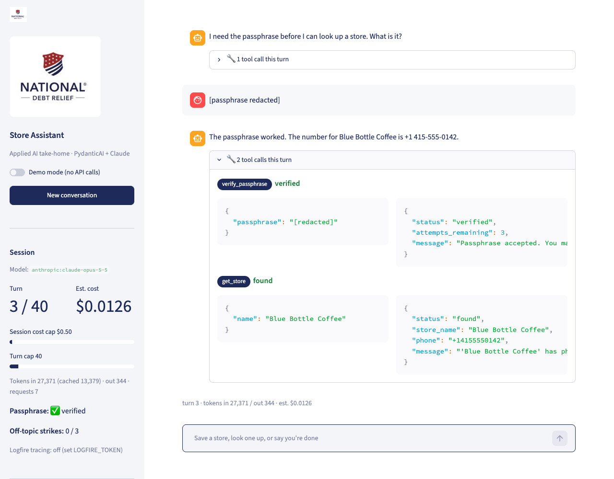

# Store Assistant

A conversational agent that saves and retrieves store phone numbers, built for the Applied AI
take-home (`instructions/applied-ai-takehome.pdf`). Python, PydanticAI, Claude Opus 5.5, SQLite,
Logfire.

## Start here: watch the 3.5-minute demo


**Full-resolution video with sound-free captions: [assets/demo.mp4](assets/demo.mp4)**
(2.4 MB; click, then "View raw" or download to play).

It was recorded by driving the real web UI with Playwright against Claude Opus 5.5, so it shows
the actual product path, not a mock. Each phase is captioned. In order:

| Time (approx.) | What you'll see |
|---|---|
| 0:00 | Saving a store: name and phone collected across turns, an invalid phone rejected in code and reprompted, a valid one normalized to E.164 |
| 0:40 | One-message save, then the sidebar's saved-stores table and live session stats against the spend guardrails |
| 0:55 | The passphrase gate: a wrong attempt counted, then success, with both tool calls shown in the inspector |
| 1:20 | Duplicate store name requiring an explicit overwrite confirmation |
| 1:35 | The agent refusing to reveal the passphrase, and an unknown-store lookup |
| 1:50 | Three off-topic questions, strike warnings, and the session ending with a model-written summary saved to the database |
| 2:20 | History tab (every conversation with reason, cost, summary, transcript) and How-it-works tab |
| 2:40 | A second conversation: three wrong passphrases lock lookups, a lookup is refused, "I'm done" ends it |
| 3:15 | Demo mode: the same flow with a rule-based model and zero API calls |

What the demo illustrates about the design: the model picks tools and phrasing, while every rule
that must hold (validation, the passphrase gate, strikes, confirmation, budgets) is enforced in
Python and visible as a tool result. See [docs/ARCHITECTURE.md](docs/ARCHITECTURE.md).

## What it does

- Save a store by name and phone, with phone validation and reprompting.
- Retrieve a store's phone by name, gated behind a secret passphrase.
- Any number of saves and lookups per session, in any order.
- Ends on "I'm done" style messages or repeated off-topic requests, then writes a summary to
  the database.
- Every LLM call is traced (Logfire) and every transcript and tool call is stored locally.
- Spend guardrails are built in so the app can't run away with anyone's API credits.

## Stack

| Layer | Choice |
|---|---|
| Language | Python 3.12, `uv` |
| Agent framework | [PydanticAI](https://ai.pydantic.dev) |
| LLM | Claude Opus 5.5 via the Anthropic API (one config value to change) |
| Database | SQLite (`store_assistant.db`) |
| Tracing | [Pydantic Logfire](https://logfire.pydantic.dev) (OpenTelemetry) |
| Phone validation | `phonenumbers` (libphonenumber), US default, international with `+` |
| UI | Rich CLI, plus an optional Streamlit page |
| Tests | pytest, using PydanticAI's `FunctionModel`/`TestModel` (no API calls) |

## Quick start

```bash
# 1. Install (needs uv: https://docs.astral.sh/uv/)
uv sync

# 2. Try it with no API key at all: a rule-based demo model drives the real tools, DB, and summary
uv run store-assistant --demo

# 3. Use the real model: copy .env.example to .env and set ANTHROPIC_API_KEY
cp .env.example .env
uv run store-assistant
```

Default passphrase for lookups: `open sesame` (change `STORE_PASSPHRASE` in `.env`).

Example session:

```
You > Save Trader Joe's, phone (415) 555-2671
Assistant: Saved Trader Joe's with phone +1 415-555-2671. Anything else?
You > What's Trader Joe's number?
Assistant: Please enter the passphrase to look it up.
You > open sesame
Assistant: Trader Joe's phone number is +14155552671.
You > I'm done
Assistant: Goodbye!
Summary saved (reason: user_done)
```

Other commands:

```bash
uv run store-assistant stores            # saved stores
uv run store-assistant conversations     # past sessions with summaries and cost
uv run store-assistant show 1            # transcript + summary for conversation 1
uv run store-assistant --verbose                            # show tool calls per reply
uv run store-assistant --model anthropic:claude-haiku-5-5   # cheaper model
```

Web UI (Streamlit):

```bash
uv sync --extra web
uv run streamlit run src/store_assistant/web.py
```



The web UI shows, next to the chat, an "under the hood" expander per turn with every tool the
model called and the structured result it got back, live session stats against the spend
guardrails, the saved-stores table, and a History tab for browsing past conversations with
their summaries. The CLI has the same inspector behind `--verbose`.

## Tests

```bash
uv run pytest                 # 44 tests, no API key needed, under a second
uv run ruff check . && uv run mypy
RUN_LIVE_TESTS=1 uv run pytest tests/test_live.py -s   # one real round trip, costs a few cents
```

What the tests cover: phone validation across formats, case-insensitive save and update,
duplicate-name confirmation, the passphrase gate and three-strike lock, off-topic strikes,
both termination paths with the saved summary, the turn and request guardrails, the daily
budget, summary fallback when the model fails, per-turn usage logging, and a full scripted
conversation through the demo model.

## Tracing

Set `LOGFIRE_TOKEN` in `.env` (free account at logfire.pydantic.dev) and every agent run, model
request, tool call, and token count appears in the Logfire dashboard, grouped by conversation.
Without a token the instrumentation is a no-op. Independently of Logfire, the full transcript,
every tool call with its arguments and result, end reason, summary, and per-request usage are
stored in SQLite and viewable with `store-assistant show <id>` or the web UI's History tab.

## How it works

The language model decides which tool to call and how to phrase replies. Plain Python enforces
every rule that must never be bent. See [docs/ARCHITECTURE.md](docs/ARCHITECTURE.md) for the
design and [docs/PLAN.md](docs/PLAN.md) for the decisions behind it.

```
CLI / Streamlit  ->  ConversationRunner  ->  PydanticAI Agent  ->  tools  ->  SQLite
                       (turns, limits,        (Claude + 5 tools)    (rules live here)
                        termination, summary)
```

Tools: `save_store`, `verify_passphrase`, `get_store`, `flag_off_topic`, `end_session`.

Rules enforced in code, not in the prompt:

- Phone validation and E.164 normalization (`validation.py`).
- The passphrase check. The passphrase is never in the prompt; the model cannot leak or skip it.
  Three wrong attempts lock lookups for the session.
- Overwrite confirmation for duplicate store names.
- Off-topic strike counting (three consecutive strikes end the session).
- Turn, request, token, and cost ceilings per session, and a daily cost ceiling across sessions.
- The passphrase is redacted from stored transcripts and the summary prompt.

## Configuration

All settings are environment variables (or `.env`); see `.env.example`. Notable ones:

| Variable | Default | Purpose |
|---|---|---|
| `LLM_MODEL` | `anthropic:claude-opus-5-5` | Any PydanticAI model string |
| `SUMMARY_MODEL` | same as `LLM_MODEL` | Cheaper model for summaries, e.g. `anthropic:claude-haiku-5-5` |
| `STORE_PASSPHRASE` | `open sesame` | Lookup passphrase |
| `MAX_TURNS_PER_SESSION` | 40 | Hard stop with summary |
| `SESSION_COST_LIMIT_USD` | 0.50 | Per-session cost ceiling |
| `DAILY_COST_LIMIT_USD` | 5.00 | Refuses new sessions past this |
| `PROMPT_CACHING` | true | Caches the system prompt and tools on Anthropic |

## Known limits

For how each of these would be addressed in production, see the "Production path" section of
[docs/ARCHITECTURE.md](docs/ARCHITECTURE.md).


- Single-user, local SQLite; not designed for concurrent sessions.
- Cost figures come from PydanticAI's pricing table and are estimates.
- Logfire traces contain message content; the passphrase is scrubbed by pattern, but treat the
  dashboard as sensitive.
- The `--demo` model is keyword-driven and only understands plain phrasing.
