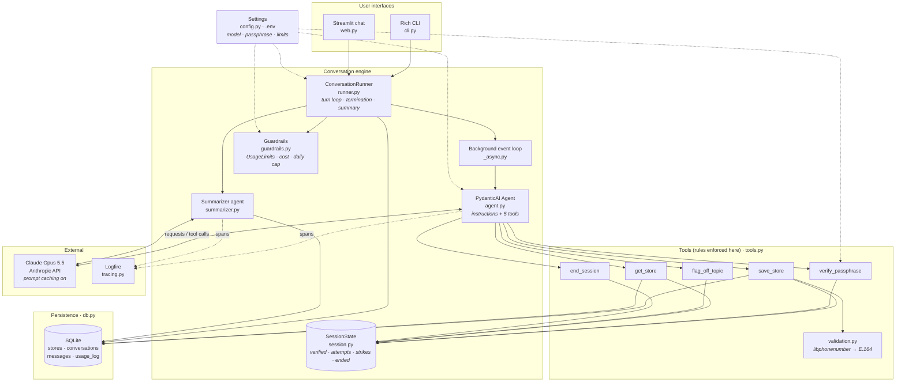
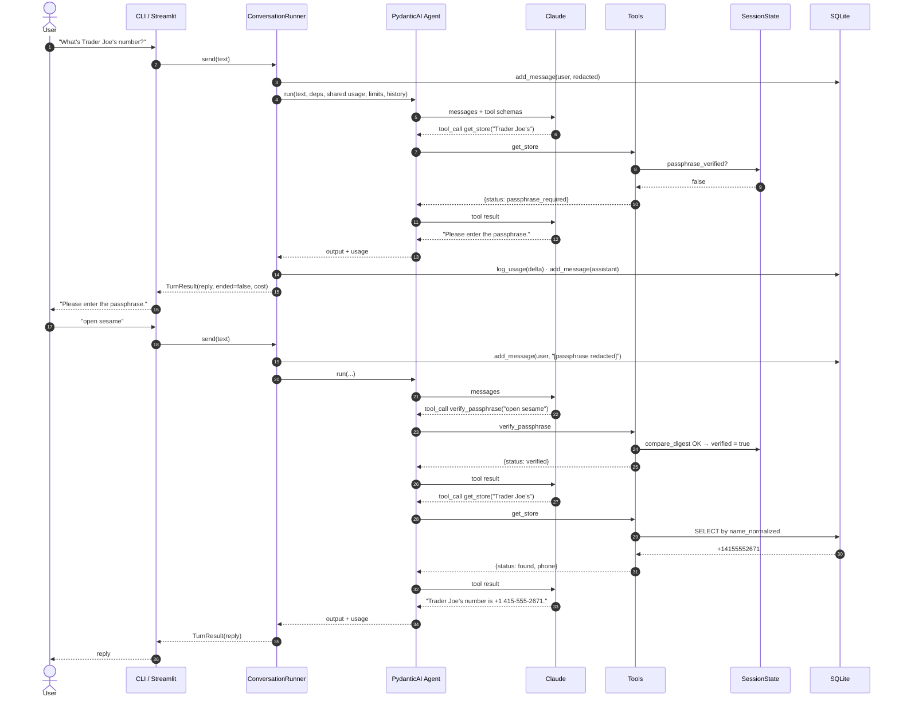
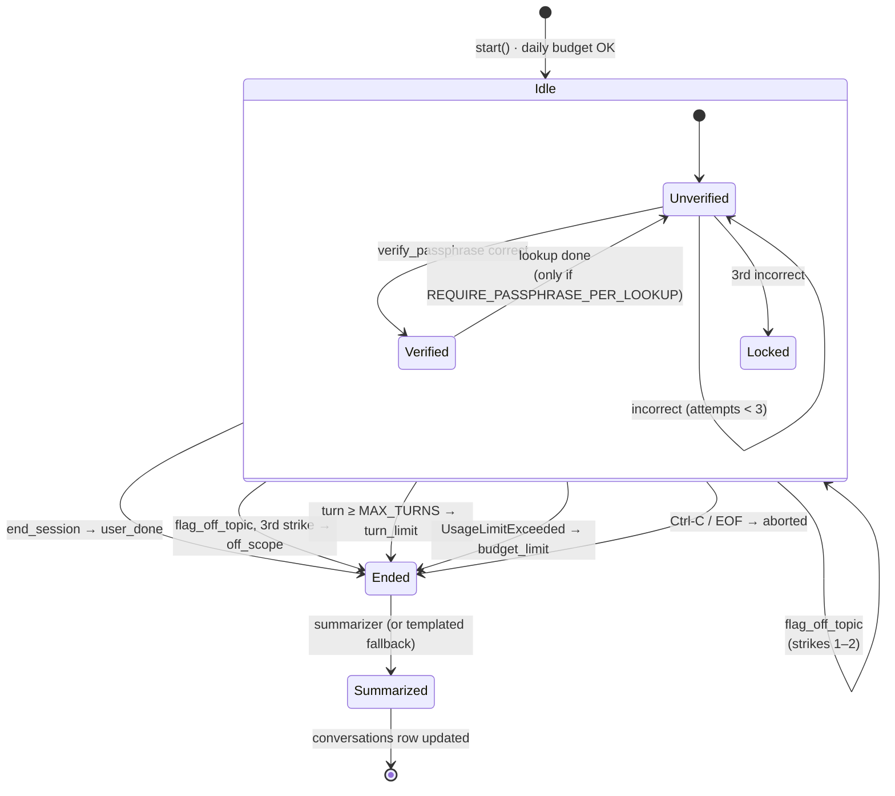
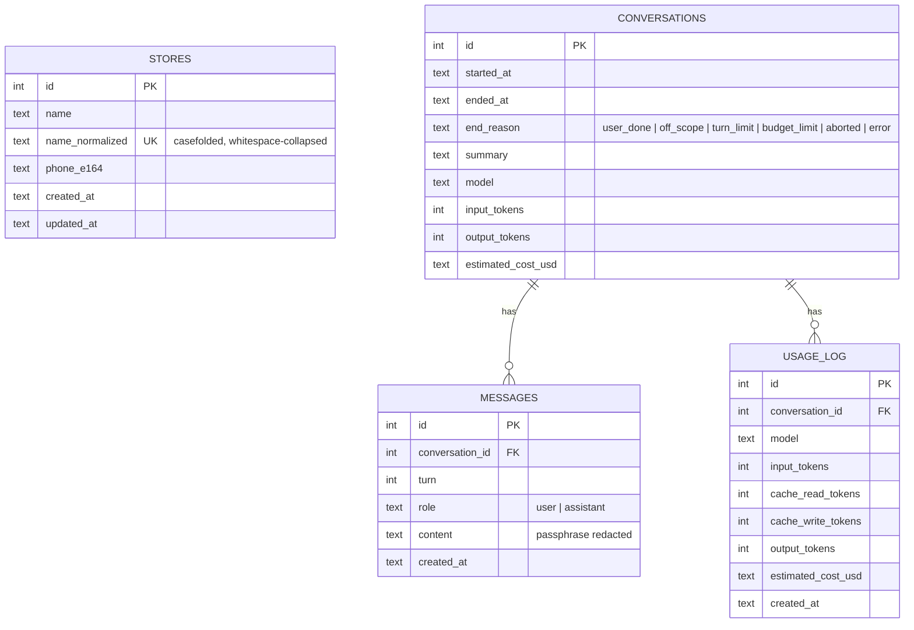
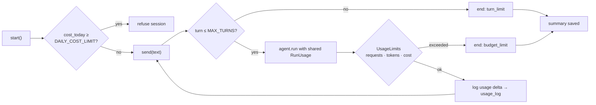

# Architecture

## The one design decision that matters

The language model is responsible for *understanding and phrasing*. Python is responsible for
*rules*. The model never holds state and cannot bend a rule, because the rule is checked inside a
tool it has to call.

## System overview

## One turn, step by step

## Session lifecycle

## Data model

## Spend guardrails

## Turn lifecycle

1. The UI calls `ConversationRunner.send(text)`.
2. The runner stores the (passphrase-redacted) user message, then runs the agent with the
   session's shared `RunUsage` and `UsageLimits`, so limits are cumulative across turns.
3. The model may call tools. Each tool reads and mutates `SessionState` and the repository.
4. The runner logs the usage delta for the turn, applies the turn cap, and stores the reply.
5. If the state is now `ended`, the runner calls the summarizer, saves the summary and end reason
   on the conversation row, and returns them in `TurnResult`.

## Why each rule lives where it does

| Rule | Where | Why not in the prompt |
|---|---|---|
| Phone validation | `validation.py`, called by `save_store` | Models hallucinate "valid"; libphonenumber doesn't |
| Passphrase | `verify_passphrase` compares against config with `hmac.compare_digest` | The model never sees the secret, so it can't leak it or be talked into skipping it |
| Lookup gate | `get_store` returns `passphrase_required` unless state says verified | The gate is a boolean the model can't set |
| Three-strike lock | `verify_passphrase` counts attempts | Deterministic and testable |
| Overwrite confirmation | `save_store` returns `needs_confirmation` unless `confirm_overwrite=true` | Prevents silent data loss |
| Off-topic termination | `flag_off_topic` counts consecutive strikes; on-topic tools reset | "Repeatedly" needs a counter |
| Turn / request / token / cost caps | `guardrails.py` + runner | Protects whoever's API key is in use |
| Daily cap | `usage_log` table summed on `start()` | Survives process restarts |

## Data model

- `stores(id, name, name_normalized UNIQUE, phone_e164, created_at, updated_at)`
- `conversations(id, started_at, ended_at, end_reason, summary, model, input_tokens, output_tokens, estimated_cost_usd)`
- `messages(id, conversation_id, turn, role, content, created_at)`
- `usage_log(id, conversation_id, model, input_tokens, cache_read_tokens, cache_write_tokens, output_tokens, estimated_cost_usd, created_at)`

## Testing strategy

- **Tool tests** call the tool functions directly with a fake context. They prove the rules.
- **Runner tests** use PydanticAI's `FunctionModel` to script exact tool-call sequences. They
  prove termination, summaries, and guardrails without an API.
- **Demo test** drives a full 13-turn conversation through the rule-based demo model, which
  exercises the real runner, tools, DB, redaction, and summary end to end.
- **Live test** (opt-in) does one real save/lookup/done round trip against Claude.

## Swapping pieces

- Model: change `LLM_MODEL`. PydanticAI supports Anthropic, OpenAI, Gemini, Groq, Ollama, etc.
- Database: replace `db.py`; nothing else imports `sqlite3`.
- UI: anything that can call `start()` and `send()` works; see `web.py`.

## Production path

What this take-home deliberately leaves out, and how each piece would be added without
changing the core design. None of it is needed for a single-user local demo, and building it
now would add setup friction for no benefit.

| Concern | Today | Production step |
|---|---|---|
| Users and auth | Single user, no login | Put the app behind an identity provider (OIDC). Add a `users` table and a `user_id` column on `stores` and `conversations`, scoped in the repository. Keep the passphrase as a per-lookup second factor |
| Database | SQLite file via `Repository` | Swap the repository for Postgres behind the same interface, add migrations (Alembic). Nothing outside `db.py` changes |
| Concurrency | One `ConversationRunner` per session, sends serialized with a lock | Move `SessionState` and message history to Redis so any instance can serve any session. Keep the lock as a per-session Redis lock |
| Async work | Summaries run inline at session end | Only if volume demands it: a queue (SQS, Redis Streams, or Kafka) for summarization, audit export, and analytics. The summarizer is already a separate agent, so it moves without changes |
| Model and cost | One model per config, per-session and daily caps | Per-user budgets, a routing table (cheaper model for summaries by default), and cost alerts from Logfire |
| Observability | Logfire traces plus local transcripts | Alerting on error rate, latency, and spend; sampling for high volume; retention policy for traces that contain message content |
| Secrets | `.env` file | A secrets manager (AWS Secrets Manager, Vault) and key rotation. The passphrase becomes a hashed per-user secret, not a shared string |
| Abuse and safety | Three-strike off-topic policy, attempt lock | Rate limiting per user and IP, input length caps, prompt-injection evals in CI, and a review of what the model may say about the passphrase |
| Privacy | Passphrase redacted from transcripts and traces | PII classification of transcripts, data-retention windows, user deletion flows |
| Delivery | `uv run` locally | Container image, health endpoint, CI running the test suite and the live smoke test on a schedule |

## Deliberate limits

- Lookups lock for the whole session after three bad passphrases (simple, safe, documented).
- Passphrase comparison is case-insensitive and whitespace-trimmed for friendliness.
- Cost estimates rely on `genai-prices` data bundled with PydanticAI.
